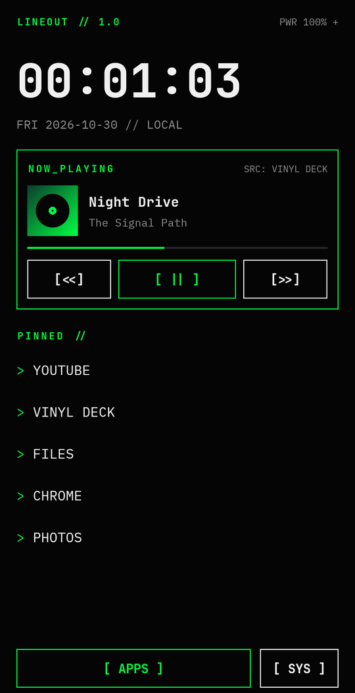
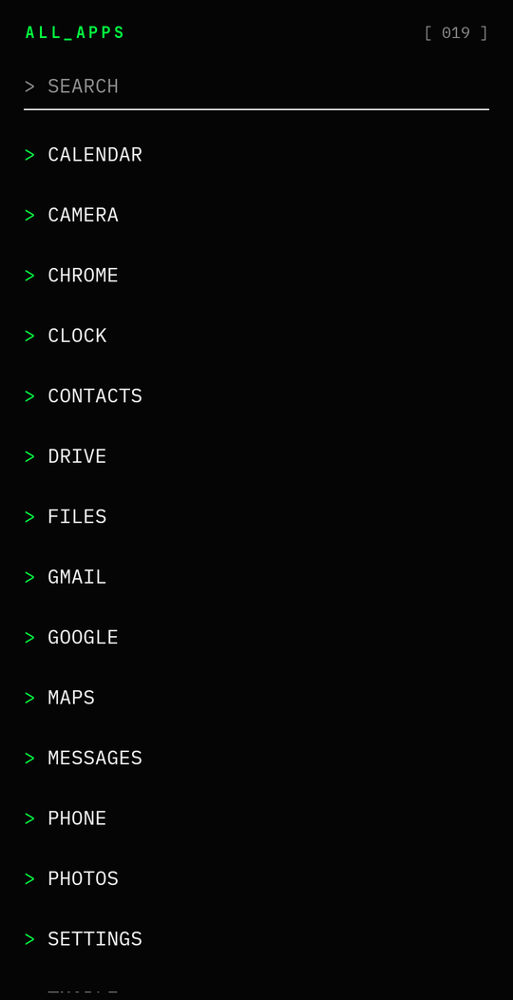
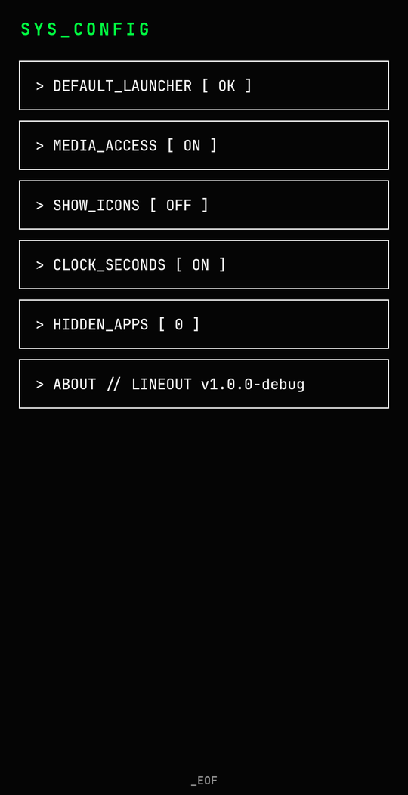
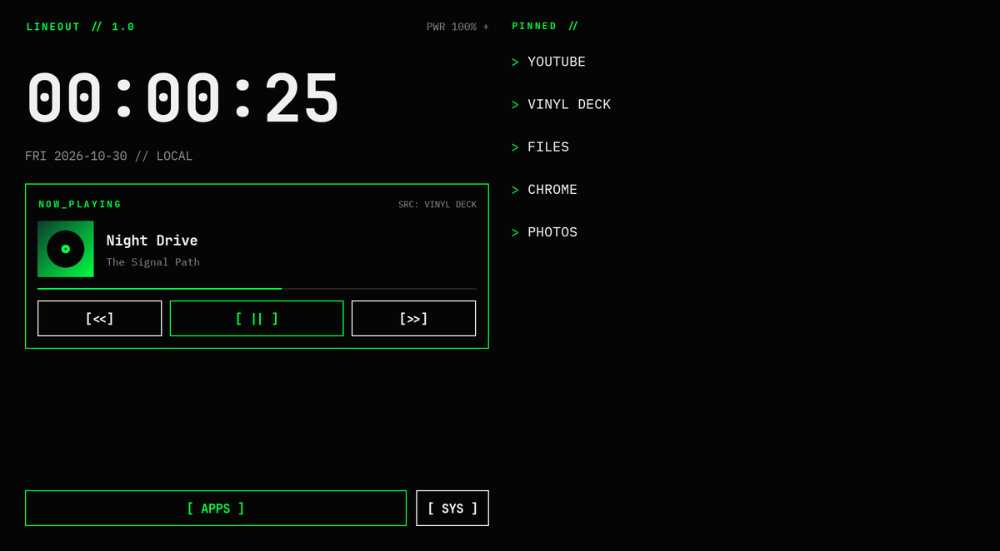
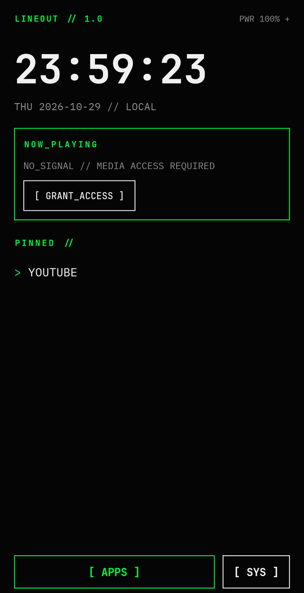
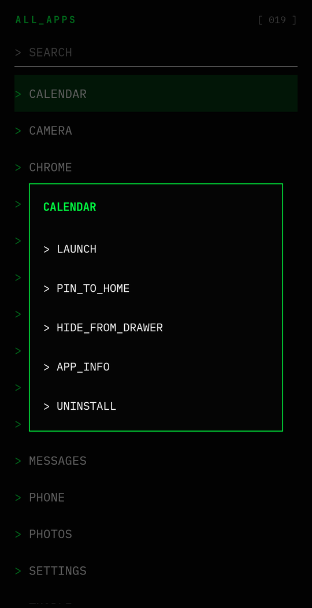

<div align="center">

# `> LINEOUT_`

**A music-first, terminal-styled Android home screen for digital audio players and tablets.**

[](https://github.com/antonflor/lineout/actions/workflows/build.yml)
[](https://github.com/antonflor/lineout/releases/latest)


[](LICENSE)

&nbsp;
&nbsp;


</div>

---

Lineout replaces your home screen with one thing that matters on a music
player: **what's playing**. A big now-playing card that works with any player,
a short list of pinned apps, and a fast searchable drawer, all in black,
white and signal green.

It's built for low-RAM media hardware like the **FiiO JM21** and budget
tablets like the **ONN 8"**. It uses only Android framework APIs, has **no
third-party dependencies**, needs no internet permission, and the APK is about
550 KB.

## Features

| | |
|---|---|
| **NOW_PLAYING** | Album art, title, artist, progress and `[<<] [ > ] [>>]` controls for **any** media app: FiiO Music, Poweramp, UAPP, HiBy, Plex, VLC, Spotify, TIDAL, YouTube… Tap the art or title to jump into the player. |
| **PINNED** | Your daily apps as `> PROMPT` rows. Installed media apps are pinned automatically on first run. Reorder with long-press → `MOVE_UP` / `MOVE_DOWN`. |
| **ALL_APPS** | Swipe up or tap `[ APPS ]`. Instant search; press Enter to launch the top hit. Long-press for `PIN` · `HIDE` · `APP_INFO` · `UNINSTALL`. |
| **Clock + power** | `HH:mm:ss` terminal clock, date line and a `PWR 087%` battery readout. |
| **SYS_CONFIG** | Default-launcher role, media access, icons on/off, clock seconds, hidden-apps manager. |
| **Adaptive layout** | Single column on phones, two panes on tablets and in landscape, two-column drawer on wide screens. |

<div align="center">

<br><sub>Tablet / landscape layout</sub>
</div>

## Install

1. Download `Lineout-x.y.z.apk` from the [latest release](https://github.com/antonflor/lineout/releases/latest).
2. Open it on the device and allow "install unknown apps" when asked,
   or run `adb install Lineout-x.y.z.apk`.
3. Open **Lineout**, then tap `[ SET_AS_DEFAULT_LAUNCHER ]`.
4. Tap `[ GRANT_ACCESS ]` on the NOW_PLAYING card and enable **Lineout** under
   notification access. Start playing something and the card lights up.

To switch back: **Settings → Apps → Default apps → Home app**.

<details>
<summary>First-run and long-press screens</summary>
<br>
&nbsp;

</details>

## Privacy and permissions

| Permission | Why |
|---|---|
| Notification listener (you grant it) | Android only lets apps read **media sessions** (track info + controls) if they hold this access. Lineout's listener is [intentionally empty](app/src/main/java/xyz/montylabs/lineout/MediaAccessListener.java): it never reads notification content. |
| `REQUEST_DELETE_PACKAGES` | Powers the `UNINSTALL` action. Android still asks you to confirm. |
| Package visibility query | A launcher has to list launchable apps. |

No internet permission, no analytics, no ads. Settings stay on the device.

## Build

Requires JDK 17 and the Android SDK (API 35). Open the project in Android
Studio, or run:

```bash
./gradlew assembleDebug        # app/build/outputs/apk/debug/Lineout-<ver>-debug.apk
./gradlew lintRelease          # static checks
./gradlew assembleRelease      # signed only if a release key is configured
```

The debug build installs as `xyz.montylabs.lineout.debug`, so it can sit next
to a release install.

### Release signing

Signing keys are **never** committed. Put a `keystore.properties` file
(git-ignored) in the project root:

```properties
storeFile=/absolute/path/to/lineout-release.jks
storePassword=...
keyAlias=lineout
keyPassword=...
```

CI reads the same values from repository secrets
(`LINEOUT_KEYSTORE_B64`, `LINEOUT_KEYSTORE_PASSWORD`, `LINEOUT_KEY_ALIAS`,
`LINEOUT_KEY_PASSWORD`). Pushing a `v*` tag builds a signed APK and attaches it
to the GitHub release.

## Project layout

```
app/src/main/java/xyz/montylabs/lineout/
├── MainActivity.java         home screen, drawer, app actions
├── MediaHub.java             picks the active media session, transport controls
├── MediaAccessListener.java  empty listener that unlocks media-session access
├── SettingsActivity.java     SYS_CONFIG
├── AppRepository.java        launchable-app query + sort
├── Prefs.java                pins (ordered), hidden apps, toggles
└── Fonts.java, Mono*.java    bundled monospace typefaces
```

## Credits

- [JetBrains Mono](https://github.com/JetBrains/JetBrainsMono) and
  [IBM Plex Mono](https://github.com/IBM/plex), both under the SIL Open Font
  License 1.1 (license texts are bundled next to the fonts).
- Designed in the [Monty Labs](https://montylabs.xyz) style.

## License

[MIT](LICENSE) © 2026 Monty Labs

```
_EOF
Connection stable. Awaiting signal.
```
